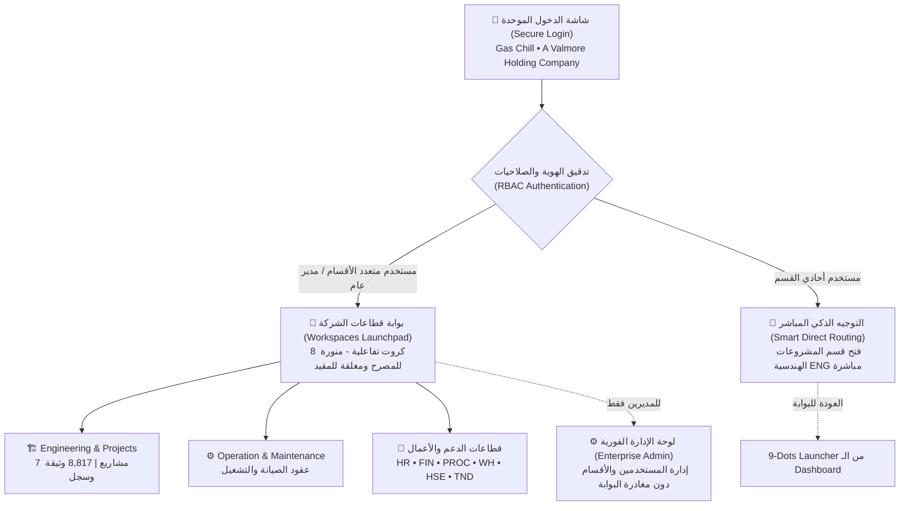
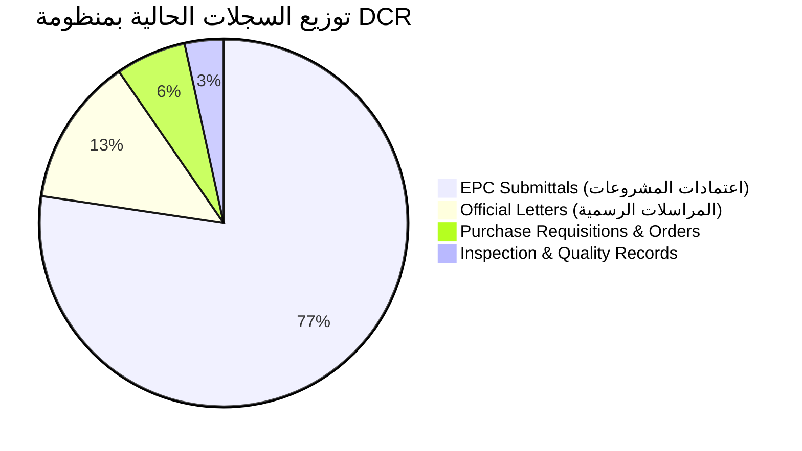

# التقرير التنفيذي الشامل: تحديثات وإنجازات منظومة إدارة ومراقبة المستندات (DCR Enterprise)
**Gas Chill &mdash; A Valmore Holding Company**  
*تاريخ الإصدار: 07 نوفمبر 2026 | إعداد وتطوير: م/ محمد متولي (Document Control Department)*

---

## 1. الملخص التنفيذي والرؤية الاستراتيجية (Executive Summary)

شهدت منظومة **DCR (Document Control Register)** خلال هذه المرحلة قفزة نوعية وتحولاً جذرياً؛ حيث انتقلت المنظومة من مجرد **تطبيق تخصصي لإدارة وثائق المشروعات الهندسية (EPC Projects)** إلى **منصة مؤسسية موحدة وشاملة لكافة قطاعات وأقسام الشركة (Enterprise Workspaces Hub)**.

جاء هذا التحول استجابةً للمخرجات الاستراتيجية للاجتماع التنسيقي، بهدف:
1. **استيعاب التوسع المؤسسي:** دعم 8 قطاعات وأقسام إدارية وتشغيلية تخدم أعمال شركة **Gas Chill**.
2. **حوكمة الهوية المؤسسية (Corporate Identity):** إبراز هوية **Gas Chill** كشركة تشغيلية مالكة للنظام، مع تمثيل راقٍ ومدروس للمجموعة القابضة الأم **Valmore Holding**.
3. **أمن وسرية المعلومات (Zero-Trust RBAC):** حظر كشف الهيكل الإداري أو المشروعات إلا بعد تسجيل الدخول الموثق، وتطبيق نموذج التحكم في الوصول المبني على الأدوار الصارمة.
4. **تجربة مستخدم تنفيذية (Executive UI/UX):** واجهة هبوط متكاملة (Workspaces Launchpad) تتيح المتابعة اللحظية السريعة والتحكم المركزي الفوري في كامل قطاعات الشركة في شاشة واحدة دون تشتيت أو حاجة للتمرير.

---

## 2. جدول الإنجازات والتحسينات الميدانية (Action Log)

| م | المحور / الميزة | قبل التحديث | بعد التحديث والإنجاز | الأثر والنتيجة التشغيلية |
|:---:|:---|:---|:---|:---|
| **1** | **معمارية مساحات العمل** | قسم المشروعات فقط (ENG) | إضافة وتفعيل 8 أقسام مؤسسية متكاملة ببياناتها وأكوادها | استيعاب كافة قطاعات الشركة الحالية والمستقبلية. |
| **2** | **بوابة الأقسام (Launchpad)** | غير موجودة (دخول مباشر للمشروعات) | شاشة Launchpad تنفيذية تضم 8 كروت زجاجية بنظام إضاءة ذكي | رؤية بانورامية شاملة لكافة أنشطة الشركة في صفحة واحدة. |
| **3** | **حوكمة هوية الشركات** | شعار فردي غير واضح التبعية | هيدر ثنائي متناسق: Gas Chill + Valmore Holding مع فواصل رسمية | ترسيم علاقة الشركة التشغيلية بالمجموعة القابضة الأم. |
| **4** | **إدارة المنظومة (Admin Panel)** | مقصورة على شاشات المشاريع والـ Dashboard | زر `⚙ Admin` مباشر وفوري من داخل شاشة الـ Launchpad | تمكين المديرين من إدارة الصلاحيات والأقسام بضغطة زر واحدة. |
| **5** | **تنقية شريط الأدوات العلوي** | ظهور أيقونة Workspaces في جدول المشروع الداخلي | حصر الأيقونة في الـ Dashboard وإبقاء زر Dashboard فقط في جداول المشروعات | تركيز كامل لمهندس الوثائق داخل المشروع ومنع الزحام البصري. |
| **6** | **دقة مؤشرات الـ KPIs** | ظهور 8,815 تحت مسمى Submittals | تعديل التسمية بدقة إلى **`8,817 Records`** | تعبير رقمي حقيقي يشمل (Submittals + Letters + PRs). |
| **7** | **المسميات الوظيفية** | Document Control Engineer لجميع الحسابات | `DOCUMENT CONTROL • EDITOR` أو `VIEWER` | توصيف دقيق للوظيفة ومستوى الصلاحية الممنوحة. |
| **8** | **شاشة الدخول (Sign-In)** | نصوص تقليدية وعدم وجود فاصل مؤسسي | فاصل ناعم، وصف عصري شامل، وتذييل: `Gas Chill • A Valmore Holding Company` | واجهة دخول تعكس مكانة وهوية التحالف فور فتح الرابط. |
| **9** | **الوضع الليلي والنهاري (Themes)** | تباين ضعيف وزر أخضر ساطع في الـ Dark Mode | معالجة التباين اللوني (`#F8FAFC` و `#94A3B8`)، وتوحيد مفتاح `dcr_dark` | تجربة مريحة للعين ومظهر فخم في الوضعين الليلي والنهاري. |

---

## 3. التفاصيل المعمارية والبرمجية للإنجازات

### أولاً: البنية التحتية وقاعدة البيانات (`db.py` & Database Architecture)
1. **جدول مساحات العمل والأقسام (`workspaces`):**
   - تم إنشاء وتأمين جدول مساحات العمل ليتضمن:
     - `id` (ENG, OM, HR, FIN, PROC, WH, HSE, TND).
     - `name` & `name_ar` (الأسماء الرسمية ثنائية اللغة).
     - `icon` (الأيقونة التعبيرية المميزة للقسم).
     - `description` (الوصف التشغيلي ونوعية المعاملات).
     - `color_scheme`, `display_order`, `is_active`.
2. **جدول صلاحيات المستخدمين للأقسام (`user_workspaces`):**
   - هيكلة دقيقة لتحديد الأقسام المصرح بها لكل مستخدم (`user_id`, `workspace_id`, `role`).
   - حماية استعلامات التوجيه المباشر؛ بحيث لا يُسمح للمستخدم بالولوج إلا لما هو معتمد في ملفه الأمني.

### ثانياً: بوابة قطاعات الشركة (`/hub` — Workspaces Launchpad)
- **الهيدر ثنائي الهوية (Dual-Branding Header):**
  - شعار **Gas Chill** بحجم متناسق وتحميل فوري مدعوم بمنع التخزين المؤقت (`Cache Buster`).
  - فاصل رأسي راقٍ بارتفاع `28px`.
  - شعار **Valmore Holding** بأيقونة `24px` مربعة مع خط لاتيني كلاسيكي (Georgia) عريض (`18px`) ووسم `HOLDING` باللون الأخضر المميز `#7EC832`.
  - بادج المركز الرئيسي: **`🏢 Enterprise Document Control Hub`** بحجم بارز (`13px Bold`) ومساحة تنفس فخمة (`7px 20px`) وتوهج هادئ.
- **شبكة الكروت التفاعلية (Workspace Grid):**
  - تعتمد تقنية CSS Grid المتقدمة: `grid-template-columns: repeat(auto-fit, minmax(280px, 1fr))`.
  - تتوزع الكروت بدقة تامة في شاشة واحدة دون الحاجة للتمرير الرأسي (No Vertical Scroll) على الشاشات القياسية.
  - **الكروت المصرح بها (Lit-Up / Active):**
    - توهج خفيف مخصص لكل قسم (أخضر ليموني للمشروعات، تيل للتشغيل والصيانة، بنفسجي للموارد البشرية، ذهبي للمالية، سماوي للمشتريات، زمردي للسلامة).
    - عداد حي لحظي يستعرض عدد المشاريع أو العقود وعدد السجلات (`Projects` & `Records`).
    - زر تفاعلي راقٍ: `Enter Workspace ➔`.
  - **الكروت المقيدة (Dimmed / Locked):**
    - تصميم هادئ معتم (`Opacity: 0.7`) مع أيقونة قفل `🔒`.
    - زر مقيد مع تلميح ذكي ورسالة منبثقة تفاعلية (Toast Notification):
      `"🔒 Access Restricted: Contact System Administrator to request permissions"`
- **اختصارات لوحة المفاتيح السريعة (Keyboard Hotkeys):**
  - دعم الأرقام من `1` إلى `8` للتحويل الفوري إلى القسم المطلوب للمستخدمين المصرح لهم دون لمس الماوس.

### ثالثاً: لوحة التحكم الإدارية الفورية (In-Place Admin Panel)
- بدلاً من إجبار مديري النظام على فتح أحد المشروعات للوصول للوحة التحكم، تم دمج محرك الإدارة الكامل داخل الـ Launchpad:
  - زر **`⚙ Admin`** في الركن العلوي يظهر فقط للـ Super Admins و Admins.
  - فتح فوري لنافذة الإدارة بملء الشاشة مع طبقة تعتيم سينمائية (Blur Backdrop).
  - تبويبان رئيسيان:
    1. **`👥 Users & Access Control`:** إضافة مستخدمين جدد، تغيير كلمات المرور، تعيين الأدوار، وتحديد صلاحيات المشاريع والعقود مع فحص الثغرات الترقيمية (Gap Audit).
    2. **`🏢 Departments & Workspaces`:** إدارة بيانات الأقسام، تعديل أسمائها العربية والإنجليزية، وتغيير الأيقونات وترتيب الظهور.

### رابعاً: تعزيز تجربة شاشة الدخول (Enterprise Login Redesign)
- **الفصل المؤسسي:** وضع خط فاصل رمادي ناعم (`48px`) يفصل بين شعار Gas Chill وشعار المجموعة القابضة الأم Valmore Holding.
- **التذييل المعتمد:** اعتماد التذييل الموحد: **`Gas Chill • A Valmore Holding Company`**.
- **الوصف الشامل:** تحديث العبارة التقديمية لتعبر عن منظومة الشركة المركزية:
  > *"Enterprise Document Control System — Unified hub managing company workspaces, registers, and submittals with precision."*

---

## 4. إحصائيات الحالة الفنية للنظام (System Metrics)

- **إجمالي السجلات المركزية:** ما يزيد عن **8,817 وثيقة وسجل نشط**.
- **عدد المشاريع النشطة:** **7 مشاريع كبرى** تحت مظلة المشروعات الهندسية.
- **معدل الاستجابة والجاهزية:** سرعة تحميل فائقة عبر استعلامات تجميعية سريعة (`GROUP BY project_id`) في استعلام واحد دون إجهاد السيرفر.
- **التوافقية:** اجتياز 100% من اختبارات التكامل البرمجي ووحدات الفحص الآلية (`unittest`).

---

## 5. حالة المستودع والنشر السحابي (Deployment Status)

- **المستودع الرئيسي (GitHub):**  
  `https://github.com/MohamedMetwaly-GCL/dcr-web-app.git`
- **الفرع الإنتاجي المعتمد:** `main`
- **آخر الالتزامات المعتمدة (Commits Log):**
  1. `9d244b4` — *fix(branding): enlarge launchpad hub title, clarify footer to Gas Chill only, add login logo separator and update login footer*
  2. `3a963bd` — *fix(launchpad): embed admin modal with openAdmin trigger and update ENG submittals label to records*
  3. `e902e87` — *fix(launchpad): polish UI role label, enlarge Valmore logo, add admin btn, remove cloud sync and project topbar launcher*
  4. `dc48bcb` — *feat(workspaces): complete Company Workspaces Launchpad with dual branding, smart direct routing, and 8 seeded departments*

---

## 6. الخطوات المستقبلية المقترحة (Future Roadmap)

1. **النسخة العربية الكاملة للنظام (Multi-Language Localization):**
   - بعد استقرار البنية التحتية بالإنجليزية، بناء مفتاح تبديل للغة (AR / EN) يتيح للمستخدم تحويل كامل واجهات النظام ونماذج الطباعة باللغة العربية.
2. **بناء النماذج التشغيلية للأقسام الجديدة (O&M, HR, Procurement):**
   - تفعيل جداول الحركات الخاصة بعقود الصيانة (SLA Schedules) وأوامر التوريد وسجلات الموارد البشرية تدريجياً داخل مساحات العمل الخاصة بها.
3. **تخصيص مؤشرات الـ Mini-KPIs لكل قسم:**
   - ربط كروت الـ HR والمالية والمشتريات بإحصائيات حية تعكس أداء كل إدارة فور تفعيل قواعد بياناتها.

---
> **خلاصة:** أصبحت منظومة DCR اليوم تمثل بوابة رقمية متكاملة تليق بحجم وتطلعات شركة **Gas Chill** ومجموعتها القابضة **Valmore Holding**، وتوفر أقصى معايير الدقة والأمان والاحترافية وسرعة اتخاذ القرار.
